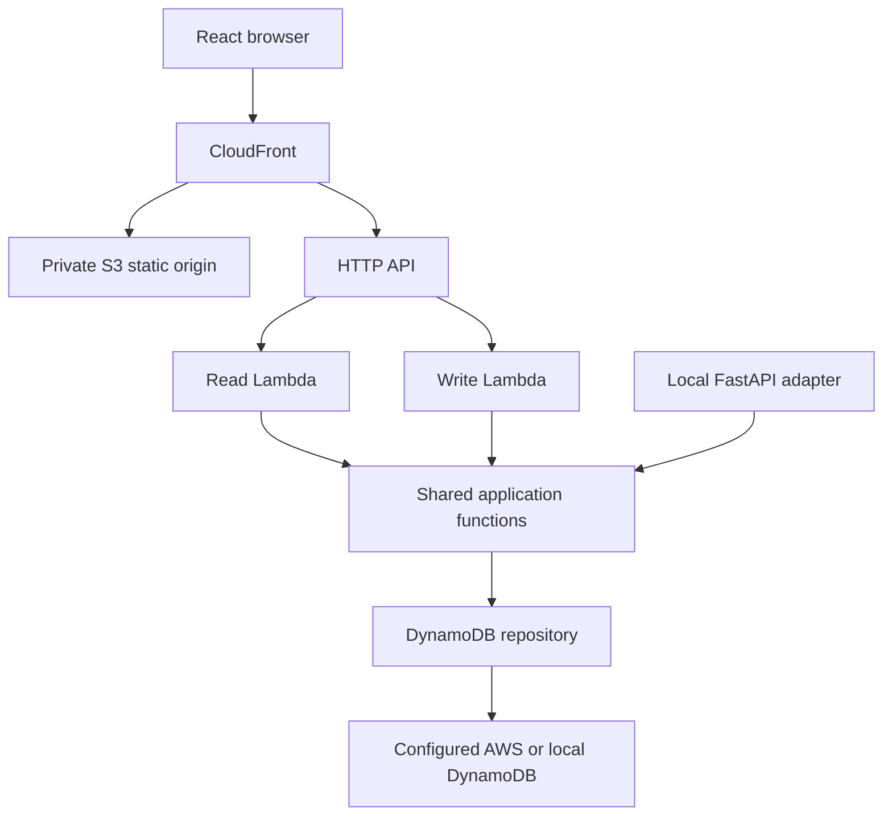

# Component Dependencies

| Consumer                    | Provider                     | Boundary                                             |
| --------------------------- | ---------------------------- | ---------------------------------------------------- |
| Browser                     | CloudFront                   | HTTPS static assets and /api/entries                 |
| CloudFront default behavior | Private S3 REST origin       | Read static objects using OAC                        |
| CloudFront /api/\* behavior | API Gateway HTTP API         | HTTPS; unchanged /api path; cache disabled           |
| API Gateway GET route       | get_entries Lambda           | Lambda proxy payload v2                              |
| API Gateway POST route      | create_entry Lambda          | Lambda proxy payload v2                              |
| Lambda adapters             | Shared application functions | Python calls                                         |
| Application functions       | EntryRepository              | Injected protocol                                    |
| DynamoDB repository         | DynamoDB table               | boto3 Query or conditional PutItem                   |
| Local FastAPI adapter       | Shared application functions | Same Python calls and error mapping                  |
| Local DynamoDB repository   | DynamoDB Local               | Explicit local endpoint and named-volume persistence |

## Data Flow

Text alternative: static requests go through CloudFront to S3; API requests go through CloudFront and Gateway to the read/write Lambda. Cloud and local adapters use one shared application layer and repository against an explicitly selected store.

## Route and Response Discrimination Check

- GET /api/entries: CloudFront /api/\* -> unchanged default-stage Gateway route -> get_entries -> JSON array.
- POST /api/entries: same behavior and path -> create_entry -> 201 JSON entry.
- Allow forwarding of POST and its body; never use a GET-only API behavior or cached mutation/read responses.
- Do not forward the CloudFront viewer Host header to the execute-api origin; origin TLS/Host must identify API Gateway.
- Do not configure a global CloudFront 403/404-to-index.html fallback that can transform API failures into HTML/200.

Dependencies are acyclic. No domain package depends on React, FastAPI, Gateway event shapes, or a particular frontend deployment hostname.
