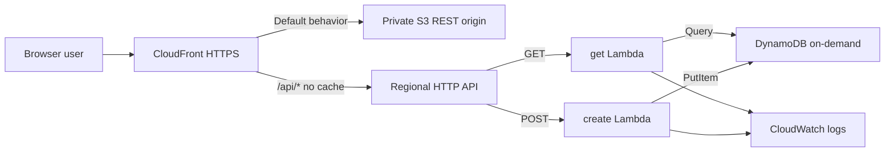

# Deployment Architecture: entries-api

## Resource Flow

Text alternative: CloudFront serves the React build from private S3 and sends uncached /api requests to Gateway. Gateway invokes separate read/write functions. Each function receives only its required table action and scoped logging permissions.

## Environment and Isolation

- One named demo stack in us-west-2; tag resources with project/environment.
- Environment name is a required Terraform input; `demo` is proposed but requires confirmation before deployment.
- Stack owns its bucket, distribution, table, functions/roles/log groups, and HTTP API. Do not add account-wide IAM permissions or production resources.
- No existing data import. Preserve source and original local JSON. Rollback may restore original app usage; do not destroy the new table or entries automatically.

## Exact Viewer Routing

| Viewer request        | CloudFront behavior | Origin request                                   | Result                |
| --------------------- | ------------------- | ------------------------------------------------ | --------------------- |
| `/` and static assets | Default             | Private S3                                       | React document/assets |
| `GET /api/entries`    | `/api/*`            | Unchanged path to HTTP API `$default` stage      | 200 JSON array        |
| `POST /api/entries`   | `/api/*`            | Unchanged path/body to HTTP API `$default` stage | 201 JSON entry        |

Do not set API origin path to `$default` or include a stage in viewer path. Do not cache `/api/*`, forward viewer Host, or rewrite API failures to `index.html`. S3 remains private. Gateway invoke permissions are scoped to this API and functions.

## Observability and Rollback

- Lambda log fields: request ID, operation, status, duration, sanitized error category. Never log request/response bodies or contact values.
- Proposed configurable 14-day retention. No Gateway body logging, WAF, dashboard, alarm, or AWS Budget resource is included.
- Proposed route throttles and function sizing are reviewable inputs, not confirmed deployment settings. Confirm values and expected charges before provisioning.
- Deploy only after application builds and API/client integration pass. Verify Gateway routes, CloudFront routing, and actual persistent POST/GET across independent invocations.
- On failure, disable/switch the edge/API path or restore the original app; retain table/data unless separately authorized.

No deployment or live AWS validation has occurred.
