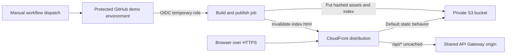

# Deployment Architecture: react-client

## Static Site and API Path

Text alternative: A manually dispatched workflow builds React. A protected environment approval precedes its short-lived OIDC role, which can write site objects and invalidate one distribution only. CloudFront serves private S3 content and routes same-origin API calls to the shared API Gateway origin.

## Publishing Sequence

1. Require an approved pull request to `main`; run build/verification without AWS credentials on pull requests.
2. Manually dispatch the deploy workflow from the protected branch.
3. Build the site, obtain approval through GitHub Environment `demo`, then request short-lived OIDC credentials.
4. Upload hashed assets with immutable cache headers, upload `index.html` with revalidation headers, and invalidate `/index.html` (and `/` only if required by observed caching).
5. Do not delete old objects. Confirm the published site and API path; a later deployment review can authorize stale-object cleanup.

## Trust Boundary

Trust exact repository `jainprateekkumar/WW-AI-Demo` and protected Environment `demo`; do not trust arbitrary branches, pull-request refs, forks, or all repositories under the owner. GitHub Actions receives no AWS session until the environment approval gate passes. Store no static AWS keys.

## Separation of Concerns

This role cannot create or modify API, Lambda, DynamoDB, IAM, CloudFront distribution, bucket policy, or Terraform resources. AWS infrastructure provisioning uses a separate reviewed/approved Release operation and confirmed local AWS identity. No automated destructive cleanup or account-wide permissions.

## Verification and Limits

Validate workflow YAML/action pins, protected environment/reviewer policy, OIDC `sub` conditions, and exact IAM resource scopes during Release. In Verify, exercise the actual hosted site and `/api/entries`; workflow syntax or a successful build alone does not prove cloud routing. No CI/CD workflow, credentials, or infrastructure has been deployed by this design.
