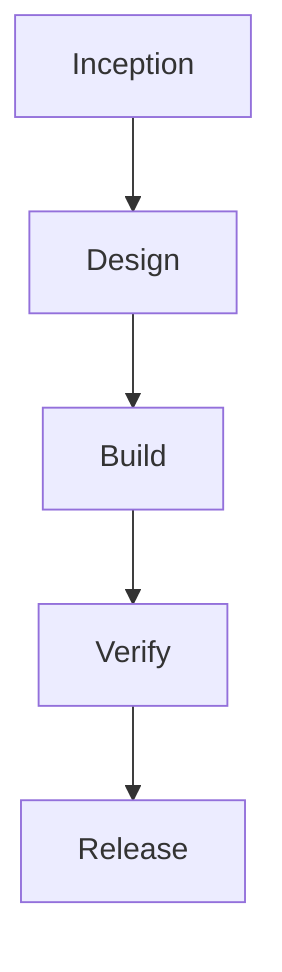

# Execution Plan

## What We'll Build

An AWS serverless version of the existing entry desk: retain React, replace the .NET API with Python Lambda behind API Gateway, and start with empty durable storage. Deploy to us-west-2 only after a separate target and cost approval.

## Key Features

- Existing submission, collection, refresh, validation, and feedback workflows.
- Durable shared persistence across Lambda invocations; no existing-data import.
- Public synthetic-data demo; no authentication or ownership feature.

## Development Approach

Develop two application units; deliver deployment definitions during Release:

1. **Entries API**: Python Lambda handlers, validation, durable-storage adapter, and tests.
2. **React Client**: retain UI, integrate the approved API, and verify local/cloud routing.

Build the API before client integration. Approve architecture and detailed design before code. Preserve existing source/data; generated implementation belongs under code/. Use conventional tests, real API read/write exercises, frontend builds, and responsive browser checks.

## Success Criteria

- Approved requirements FR1-FR6 and acceptance criteria are met or explicitly reported blocked.
- API routes, payloads, errors, and local ports match between both units.
- Deployment requires authorized AWS access, confirmed environment/account, infrastructure review, and explicit resource-creation approval.

## Workflow Selection

### Inception (completed)

- [x] Workspace Detection - completed - React and .NET packages identified.
- [x] Reverse Engineering - completed - baseline explicitly approved.
- [x] Workflow Type Selection - completed - user chose Simple.
- [x] Requirements Analysis - completed - requirements explicitly approved.

### Inception

- [ ] User Stories - `inception:user_stories` - optional - user chose to skip; existing journeys and acceptance criteria suffice.
- [x] Units Generation - `inception:units_generation` - required - separate API and frontend units require coordinated contracts.

### Design

- [x] Application Architecture - `design:app_architecture` - required - replace API/runtime and introduce AWS components.
- [x] Functional Design - `design:functional_design` - required - define validation, persistence, and client behavior.
- [ ] NFR Requirements - `design:nfr_requirements` - optional - user chose existing requirements instead of separate documents.
- [ ] NFR Design - `design:nfr_design` - optional - user chose basic safeguards within architecture/infrastructure design.
- [x] Infrastructure Design - `design:infrastructure_design` - optional - user explicitly included AWS resource and permission design.
- [ ] Figma Designs - `design:figma_designs` - optional - user explicitly chose to retain the existing appearance.

### Build

- [x] Code Generation - `build:code_generation` - required - implement both approved application units.
- [x] Build and Test - `build:build_and_test` - required - build and exercise actual behavior, not mocks alone.

### Verify

- [x] Quality Assurance - `verify:quality_assurance` - required - execute checks and record evidence and limitations.

### Release

- [x] Operations - `release:operations` - required - requested Terraform, runbook, and conditional actual AWS deployment.

## Sequence

Text alternative: approve scope and units, approve architecture and per-unit designs, build API then client, verify integration, and prepare/deploy infrastructure only after approval. Diagram identifiers and delimiters checked for valid simple flowchart syntax.

## Risk and Coordination

- JSON files are not a Lambda database; use a durable shared store.
- All entries are public; use synthetic data and make no privacy or production-certification claim.
- Current server retrieval order differs from client prepend order; make any ordering change explicit in design.
- Frontend hosting/API path routing, permissions, and configuration must agree exactly.
- Confirm environment, account/profile, budget guardrails, and prerequisites before any cloud mutation.
- Preserve the existing application and data-bearing resources unless destructive changes are explicitly authorized.

## Time and Gate Validation

Simple depth means concise artifacts. The original under-20-minute target is not a reliable end-to-end commitment for a multi-component migration with approvals and AWS deployment. All five phases remain scheduled; required stages are included. Deployment depends on tooling and authorized access, not yet checked.

## Plan Progress

- [x] Assess existing code and approve requirements.
- [x] Collect optional-stage choices.
- [x] Generate execution plan.
- [x] User approval of this plan: A) Approved - continue to unit planning.
- [x] Approve unit decomposition: A) Approved - continue to Design.
- [ ] Complete and approve Design.
- [ ] Complete and approve Build.
- [ ] Complete and approve Verify.
- [ ] Complete Release and any authorized deployment.
